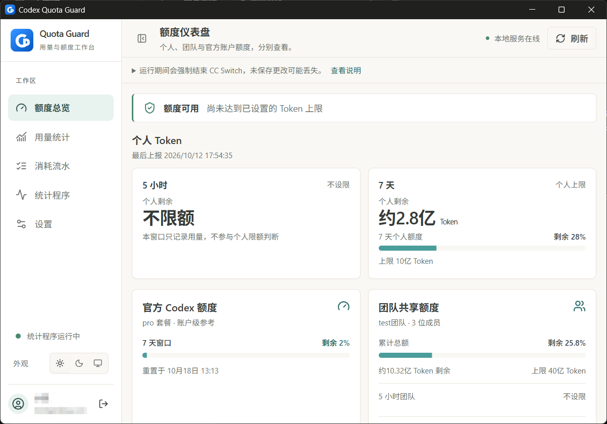
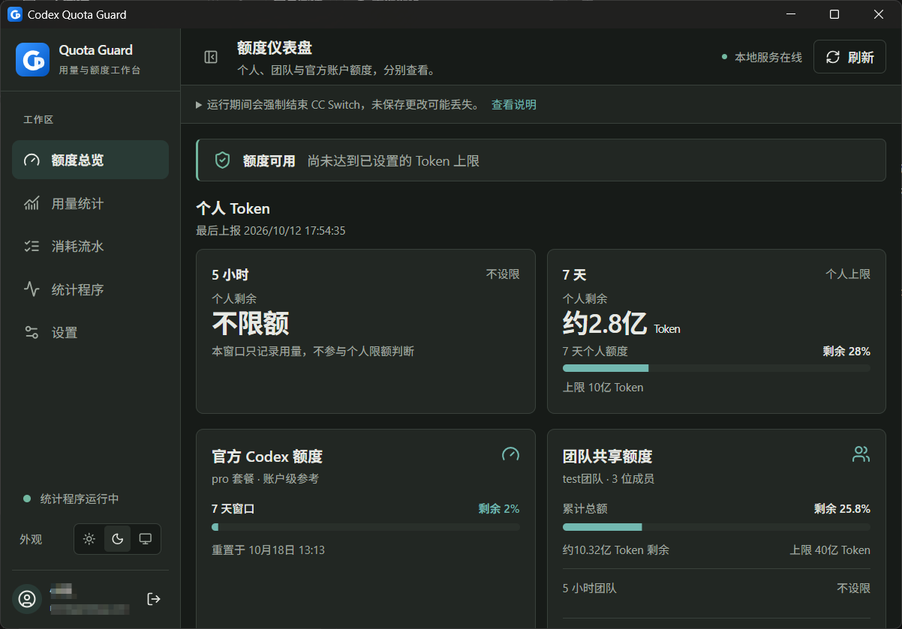
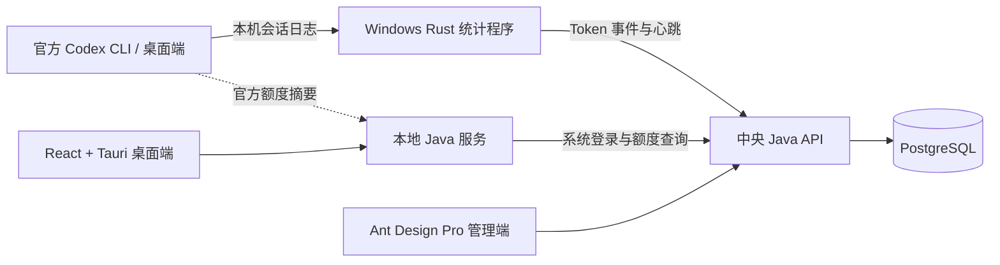

<p align="center">
  
</p>

<h1 align="center">Codex Quota Guard</h1>

<p align="center">本机记录 Codex Token 用量，集中查看个人与团队额度。</p>

<p align="center">
  <a href="https://github.com/3240665200/Codex-Quota-Guard/releases/latest"></a>
  
  
  
  <a href="https://hub.docker.com/r/minjm/codex-quota-guard-backend"></a>
</p>

<p align="center">
  <a href="https://github.com/3240665200/Codex-Quota-Guard/releases/latest">下载 Windows 安装包</a>
  · <a href="#快速开始">快速开始</a>
  · <a href="#docker-服务器部署">Docker 部署</a>
  · <a href="#功能概览">功能概览</a>
  · <a href="#界面预览">界面预览</a>
  · <a href="./docs/README.md">项目文档</a>
</p>

---

Codex Quota Guard 由桌面客户端、中央 Java 服务和 Web 管理后台组成。用户在**官方 Codex 应用或 CLI 自行登录**，桌面端不替换本机 `auth.json`。管理员可使用运行时私有授权预置或导入授权文件，验证官方账户后加密保存限定凭据。网页通过用户自己的浏览器打开官网，服务器镜像不安装浏览器。HTTP 与 HTTPS 都可用，推荐 HTTPS 保护密码与授权。Windows 统计程序从本机可读取的 Codex 会话日志采集 Token 事件，上报中央服务；管理员在后台配置团队与个人额度、查看用量和设备状态。

当前版本为 **0.3.22**，包含 Windows x64 桌面客户端、中央后端与管理网页；独立统计程序版本为 **0.2.4**。桌面端修复 HTTP／HTTPS 服务器地址访问，移除旧官方登录助手，并调整 CC Switch 冲突判定为默认共存。变更、验证范围与升级说明见[0.3.22 发布说明](./docs/releases/v0.3.22.md)。

后端与网页使用相同的 `0.3.22` 版本。每个官方账户必须绑定一个已启用代理节点；没有节点或节点故障时拒绝官方请求，不回退直连。代理页面通过名称、协议、主机、端口及可选用户名／密码添加 HTTP、HTTPS、SOCKS5 节点，测试可查看出口 IP、国家、地区和城市，订阅导入已停用。授权仍可使用运行时私有预置或手工导入文件；公开发布不包含浏览器扩展、个人授权文件或自动 Cookie 采集功能。打开 `https://chatgpt.com/` 不会自动读取跨站 Cookie，也不会自动完成 OAuth。HTTP 页面保留风险提示，HTTPS overlay 可显式强制加密传输。

当前源码另有尚未发布的[订阅与双节点代理链](./docs/proxy-subscriptions-and-chains.md)：支持手动更新 Clash/Mihomo YAML、URI/Base64 订阅，每个账户可选择“前置 → 出口”；失败不回退直连。公开 `0.3.22` 镜像仍以上述已发布行为为准。

在 Windows 本机测试这项新功能，请按[管理网页本地启动与测试指南](./docs/local-admin-test.md)从当前源码工作区启动。双击 `一键启动-管理后台.cmd` 会启动回环管理网页（8000）和中央 API（18080），并显示本次运行的停止命令；无需同时启动桌面客户端。

客户端保留「登录辅助」：管理员可为团队关联的官方账户配置自有邮箱和最多两个精确发件地址，用户点击监听后领取一封新到登录邮件中的验证码。邮箱授权只在中央服务加密保存，官方登录仍由用户完成；详见[邮箱配置与使用说明](./docs/architecture/login-assistance.md)。

## 功能概览

| | 能做什么 |
| --- | --- |
| 📊 **额度看板** | 桌面端查看官方账户返回的额度窗口百分比，以及本系统单独配置的个人、团队 Token 额度。管理后台可查看已上报的官方额度摘要。 |
| 🧮 **用量与费用** | 查看输入、输出、缓存、思考 Token、模型名称、思考等级、趋势和逐笔流水；按可配置的模型单价估算 USD。 |
| 👥 **团队管理** | 在团队页面搜索并批量选择成员，加入、移出或跨团队转移；管理个人/团队额度及累计总额，支持额度重置、设备状态查看和系统账户强制下线。 |
| 🔗 **账户与绑定** | 管理官方账户连接和会话，自动排队、识别绑定与交接，取得名额后有 30 分钟完成登录；系统用户退出与官方会话退出分别确认，支持 HTTP 与 HTTPS，推荐 HTTPS。 |
| 🛠️ **常驻统计与诊断** | Windows Rust 统计程序独立于桌面窗口运行，增量上报用量与心跳；桌面端可查看消耗流水和运行诊断。 |
| 🎨 **独立工作区** | v0.3.0 桌面端采用可收起侧栏，分开查看额度、统计、流水与诊断；支持浅色、深色、跟随系统，流水明细在弹窗中展开。 |

> [!IMPORTANT]
> **官方额度、本系统 Token 额度和估算 USD 是三套不同的数据。** 官方百分比不能精确换算为 Token，估算费用不是官方账单。本系统可统计并提示限额状态，但官方 Codex 请求不经过本系统，无法据此强制阻断官方应用。

## 界面预览

桌面客户端支持浅色、深色与跟随系统。点击截图可查看大图。

<table>
  <tr>
    <th width="50%">浅色模式</th>
    <th width="50%">深色模式</th>
  </tr>
  <tr>
    <td><a href="./docs/images/desktop-light.png"></a></td>
    <td><a href="./docs/images/desktop-dark.png"></a></td>
  </tr>
</table>

截图中的账户名和邮箱已由提供者遮挡；额度数值仅为截图时的状态，不代表默认配置或固定套餐额度。

## Docker 服务器部署

服务器镜像使用以下 Docker Hub 仓库，**公开拉取，无需上传源码或在服务器编译**：

- [后端 · minjm/codex-quota-guard-backend](https://hub.docker.com/r/minjm/codex-quota-guard-backend)
- [管理网页 · minjm/codex-quota-guard-web](https://hub.docker.com/r/minjm/codex-quota-guard-web)

部署配置固定后端和网页 `0.3.22`，支持 **Linux amd64 / x86_64**，数据库使用官方 `postgres:17-alpine`。后端保留 sing-box，不含 Chromium，也没有浏览器变体，不需要浏览器 seccomp 或额外容器权限；HTTPS overlay 可选，详见[部署说明](./deploy/docker/registry/README.md)。私有授权通过 `./secrets:/run/secrets` 只读挂载，真实凭据不进入源码、公开镜像或公开包。Windows 桌面客户端和 Rust 统计服务仍安装在用户电脑。版本范围见[0.3.22 发布说明](./docs/releases/v0.3.22.md)；旧版本标签保持不变。

服务器准备好 **Docker Engine、Docker Compose v2.24.4+、Bash、curl 和 OpenSSL** 后，可使用镜像或配套离线包部署。以下配置固定在 `v0.3.22` 标签，替换服务器 IP 和管理员邮箱：

```bash
(
  set -e
  mkdir codex-quota-guard-server
  cd codex-quota-guard-server
  qg_base="https://raw.githubusercontent.com/3240665200/Codex-Quota-Guard/v0.3.22/deploy/docker"
  curl -fSL --fail-early --remote-name-all \
    "$qg_base/registry/compose.yaml" \
    "$qg_base/registry/start.sh" \
    "$qg_base/deploy.sh" \
    "$qg_base/.env.example" \
    "$qg_base/init-db.sql"
  bash start.sh init http://服务器IP:8080 管理员邮箱
  bash start.sh up
)
```

以上下载地址固定到 `v0.3.22` 源码标签，只下载 5 个小文件，不下载整个项目；已有同名目录时会停止，避免覆盖旧部署。初始化会提示设置管理员密码，保存独立密钥到 `.env` 并创建空 `secrets` 目录；预置文件不存在时服务仍可启动，管理员可手工导入授权文件。启动后，**管理网页和桌面客户端都使用 `http://服务器IP:8080`**。基础 Compose 的 `APP_REQUIRE_HTTPS=false` 允许 HTTP 和 HTTPS 官方管理操作；启用 HTTPS overlay 后则强制 HTTPS。按需放行网站入口端口，不要单独开放数据库或后端端口。

> [!WARNING]
> HTTP 会明文传输密码、系统令牌和导入的官方授权，推荐使用 HTTPS。允许 HTTP 不改变上游官方 TLS 校验、鉴权或密钥加密。新部署不会带入原电脑的用户和流水，需要另行迁移数据库。升级前先备份，保留原 `.env` 和数据库卷，**不要执行 `docker compose down -v`**。`latest` 后续可能变化，生产部署建议固定版本。

进入 `codex-quota-guard-server` 目录后，可用 `bash start.sh status` 查看状态、`bash start.sh logs backend` 查看日志、`bash start.sh backup` 备份、`bash start.sh stop` 停止并保留数据。

从 `0.3.18/0.3.19/0.3.20` 升级到 `0.3.22` 会新增 **V31 代理测试元数据迁移**，不改写已有代理凭据。先备份并保留原 `.env`、数据库卷和全部密钥，同时更新后端与网页，建议升级桌面至 `0.3.22`；在发起任何官方账户请求前，先为该账户选择已启用代理节点。旧浏览器 overlay 不再使用，保留所选 HTTP/HTTPS 配置，详见[升级步骤](./deploy/docker/registry/README.md#升级到-0322)。从 `0.3.11` 升级会执行 **V22–V31**，V29 前必须停止全部旧应用写入进程；不要重新初始化或删除数据库卷，见[旧版本升级说明](./deploy/docker/registry/README.md#从-0311-或更早版本升级)。

详细说明：[Docker Hub 拉取部署](./deploy/docker/registry/README.md) · [离线镜像部署](./deploy/docker/offline/README.md) · [从源码构建镜像](./deploy/docker/README.md)。

## 快速开始

桌面安装包面向 **Windows x64**，包含本地 Java 运行时、WebView2 离线安装器和 Rust 统计程序；用户电脑**不需要**安装 Java、Maven、Node.js、pnpm 或 Rust。请从 [GitHub Releases](https://github.com/3240665200/Codex-Quota-Guard/releases/latest) 下载并核对 `0.3.22` 安装包。

1. 部署中央 Java API、PostgreSQL 和管理后台。Linux 服务器推荐使用上面的 [Docker 镜像部署](#docker-服务器部署)，默认支持 IP + HTTP；管理员创建系统用户、团队并设置额度。手动部署见[管理端后端文档](./apps/admin/backend/README.md)。
2. 安装与服务器配套的 `0.3.22` 桌面版本。在登录页的“服务器设置”中保存中央服务地址，例如 `https://your-server.example.com` 或 `http://<服务器 IP>:8080`。保存后从**系统托盘菜单退出客户端**，不要只关闭窗口。`0.0.0.0` 是监听地址，不能作为其他电脑的连接地址。
3. 以**管理员身份运行安装后的桌面程序**，让客户端安装、升级并启动 `CodexQuotaGuardMeter` Windows 服务；然后登录 Quota Guard **系统账户**完成设备配对。0.2.20 起每次启动都要求管理员权限，启动检查页也可保存服务器地址并重试。
4. 在客户端「登录辅助」申请绑定，按引导取得登录名额后，在该电脑的**官方 Codex 应用或 CLI** 中自行登录对应官方账户。等待中央后台自动识别并保存绑定，当前访问核验允许后再查看官方额度、个人/团队用量、逐笔流水和统计程序状态；绑定记录保存不等于访问核验已通过。

安装程序本身不会注册统计程序的 Windows 服务；若安装失败，可在客户端查看失败步骤，或参照[架构文档的排障章节](./docs/architecture/current-system-architecture.md#日志与排障)。正式部署应使用 HTTPS；局域网 HTTP 会明文传输本系统登录信息。

0.3.10 起，Windows 桌面端会在本机加密保留 **Quota Guard 系统登录状态 7 天**。关闭窗口、从托盘退出或重启电脑后可自动恢复；首次升级需重新登录一次。期限从这次登录起计算，自动续期不会延长这 7 天。主动退出登录会清除本机状态，管理员强制下线或禁用账户后也需重新登录。不会保存密码，不改变官方 Codex 登录方式。详见[登录状态存储](./docs/architecture/current-system-architecture.md#桌面登录状态存储0310)。

### 桌面自启动（0.3.8 普通启动项）

Windows NSIS 使用 **currentUser** 安装方式，可自行选择安装目录，不要求放在 Program Files。安装器本身不登记自启动；正式版桌面程序首次以**当前 Windows 用户的管理员身份启动**时，才默认登记普通启动项 **Codex Quota Guard**。可以在 **任务管理器 → 启动应用** 或客户端 **设置 → 开机自启动** 中启用、禁用；回到客户端设置页会重新读取 Windows 状态，不会把外部禁用的启动项自动打开。

这控制的是**用户登录 Windows 后打开桌面程序**，不是统计服务的开机启动；关闭它不会停止 `CodexQuotaGuardMeter`。普通启动项先启动未提权的程序，再通过 Windows 正常 UAC 流程请求当前用户的管理员权限；取消授权或改用另一账户的凭据时，不继续启动客户端、Java 或统计守卫。不创建静默管理员启动任务，也不绕过 UAC。开发版不会自动登记自启动。

0.3.7 起，普通双击与登录自启动都会在权限不足时通过正常 UAC 请求管理员权限；已获得权限时不会重复请求，取消授权则退出启动器。请勿给主 EXE 永久勾选兼容性选项“以管理员身份运行”，否则普通登录启动入口可能在进入程序前被 Windows 阻止。这是需要用户授权的启动流程，不是静默提权。

**旧版迁移**：新版首次获得管理员权限后，核对当前用户及安装目录，将本软件旧计划任务迁移为普通启动项并移除旧任务，避免重复启动；原来的关闭选择会保留。发现其他目录的同名记录、未知 Windows 状态或迁移失败时会提示，不擅自覆盖。只更新源码不会改变已安装版本，需要重新打包并升级。

### 旧版升级兼容（0.3.5 起）

安装器同时检查“当前用户”和“所有用户”的旧安装记录，包括 32/64 位注册表视图；软件名称和应用 ID 保持不变。当前用户安装默认沿用原自选目录；发现所有用户版本时，先显示旧版本、原目录和目标目录，经确认后通过 Windows UAC 卸载旧程序，再安装当前用户版本。取消授权、卸载失败或旧版记录残留都会停止安装，不会继续创建第二份。

迁移不清除应用数据，也不卸载独立统计服务；新程序首次获得管理员权限后按原开关恢复自启动。若发现多个安装目录或记录损坏，会提示处理，不猜测要删除哪份。**已发布的 0.3.4 安装包不包含这次兼容修复，源码更新不会自动改变旧安装包。**

## 系统如何协作



桌面端的本地 Java 服务仅监听回环地址；中央 Java API 管理用户、团队、额度和已入库的用量事件。更完整的数据流见[当前系统架构](./docs/architecture/current-system-architecture.md)。

## 从源码运行

开发电脑需要 Java 17、Maven 3.9+、Node.js 22+、pnpm 10.12.3；运行或构建桌面端还需要 Rust 1.85+ 和对应平台的 Tauri 依赖。中央服务需要 PostgreSQL。先参照 [`apps/admin/backend/.env.example`](./apps/admin/backend/.env.example) 将数据库和 JWT 配置注入启动环境。

Windows 可直接使用仓库根目录的 [一键启动-管理后台.cmd](./一键启动-管理后台.cmd) 和 [一键启动-桌面客户端.cmd](./一键启动-桌面客户端.cmd)。桌面脚本会在 UAC 授权后以当前 Windows 用户提权启动 pnpm 桌面端；首次安装提示会先于 UAC 出现，批准时须使用启动脚本的同一 Windows 账户，取消或切换账户都会明确失败。也可以分别在终端运行：

```bash
pnpm install
```

然后在**三个不同终端**分别运行 `pnpm dev:admin-backend`（中央 API，默认 8080）、`pnpm dev:admin`（管理页，默认 `http://localhost:8000`）和 `pnpm dev:client`（桌面端，Windows 需管理员终端）。Windows 一键启动桌面脚本还会检查、安装或启动独立统计程序。普通用户电脑请使用发布的安装包，不必配置源码开发环境。

## 构建与验证

```bash
pnpm verify
```

在 Windows 上打包桌面安装程序：

```powershell
& .\scripts\windows\package-client.ps1
```

默认产物目录为 `D:\BuildCache\pingche\desktop-package-target\release\bundle\nsis`。打包电脑没有 D 盘时，可传入 `-TargetDirectory 'C:\BuildCache\codex-quota-guard'` 自行指定目录；首次构建需要联网下载并校验随包运行时。也可双击 [一键打包-桌面客户端.cmd](./一键打包-桌面客户端.cmd) 使用默认设置。

## 项目结构

```text
apps/
  admin/
    frontend/   Ant Design Pro 管理界面
    backend/    中央 Java API
  client/
    frontend/   React + Tauri 桌面端
    backend/    本地 Java 服务
    meter/      Windows Rust 统计程序
docs/          架构、API 与产品文档
deploy/docker/ 镜像拉取、离线与源码构建部署
scripts/       启动、打包与诊断脚本
```

## 使用边界

- 统计只覆盖**本机可读取且格式受支持**的 Codex 会话日志；ChatGPT 桌面聊天、其他设备或自定义日志位置不保证计入。首次配对只建立旧日志游标，不追溯旧用量；未配对或上报失败时显示的 `0 Token` 不代表真实用量为零。
- 统计程序有独立于桌面客户端的版本号；升级统计程序不会自动补齐旧版本未采集的流水或 Token 分项。
- Windows 常驻服务已实现；macOS/Linux 尚无对应常驻服务安装器和已发布安装包，当前桌面启动门禁会明确提示平台暂不支持。拥有设备管理员/root 权限的人仍可停止服务或修改本机日志。
- `0.3.22` 桌面端与 `0.2.4` 统计程序默认允许 CC Switch 共存。只有当前账户明确使用 API Key、处于 `PROXY_MANAGED` 且没有 OAuth，同时本机活动 CC Switch 数据库记录证明正在接管 Codex，才构成冲突。统计服务还需核验受保护 `ProgramData` 证据及同一 SID／SessionId 的精确进程身份，才会结束冲突进程并弹出提示；未保存内容可能丢失。普通网络失败、仅安装或运行 CC Switch 不会触发结束进程。
- 冲突后的连接修复仅使用可验证的标准目录备份或明确选中的原供应商配置，保留现有 OAuth 与其他设置。来源不可靠、自定义目录或写入失败时会阻止继续启动并支持“重新检查”。修复不能代替官方账户归属校验，Codex 可能需要重启或重新打开会话以重载连接。
- 管理员“强制下线系统账户”只撤销 **Quota Guard 系统会话**，不会退出官方 Codex；“强制下线所有账户”和官方会话登出需分别预览并明确确认目标。个人额度用尽不能强制停止官方 Codex 的请求。
- 模型费用基于可配置的单价与已采集的 Token 分项估算；内置价格是 [CC Switch](https://github.com/farion1231/cc-switch) 的固定版本快照，**不是实时官方报价**。详见[统计与定价口径](./docs/architecture/usage-pricing.md)。

## 文档

- [文档索引](./docs/README.md) · [当前系统架构](./docs/architecture/current-system-architecture.md)
- [个人 Token 统计](./docs/architecture/local-codex-token-quota.md) · [团队额度策略](./docs/architecture/team-quota-policy.md)
- [用量与 USD 估算](./docs/architecture/usage-pricing.md) · [Web API 契约](./docs/api/web-backend-api.md)

管理端界面基于 [Ant Design Pro](https://github.com/ant-design/ant-design-pro) 定制；README 的首页排版参考 [CC Switch](https://github.com/farion1231/cc-switch) 与 [NextDevTpl](https://github.com/evepupil/NextDevTpl)。
