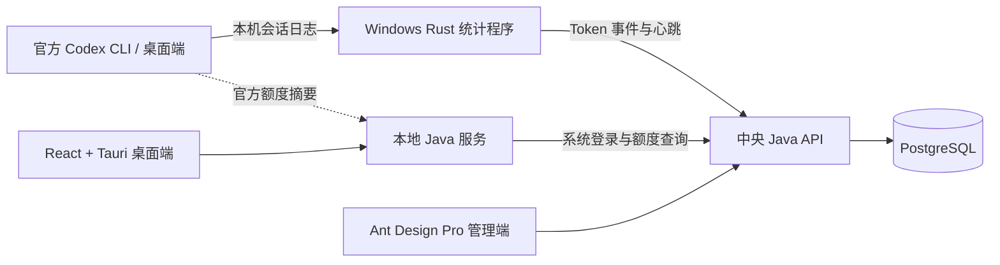

<p align="center">
  
</p>

<h1 align="center">Codex Quota Guard</h1>

<p align="center">本机记录 Codex Token 用量，集中查看个人与团队额度。</p>

<p align="center">
  <a href="https://github.com/3240665200/Codex-Quota-Guard/releases/latest"></a>
  
  
  
</p>

<p align="center">
  <a href="https://github.com/3240665200/Codex-Quota-Guard/releases/latest">下载 Windows 安装包</a>
  · <a href="#快速开始">快速开始</a>
  · <a href="#功能概览">功能概览</a>
  · <a href="#界面预览">界面预览</a>
  · <a href="./docs/README.md">项目文档</a>
</p>

---

Codex Quota Guard 由桌面客户端、中央 Java 服务和 Web 管理后台组成。用户在**官方 Codex 应用或 CLI 自行登录**；本项目不托管、下发或替换官方会话凭据（例如 `auth.json`）。Windows 统计程序从本机可读取的 Codex 会话日志采集 Token 事件，上报中央服务；管理员在后台配置团队与个人额度、查看用量和设备状态。

新增「登录辅助」：管理员可为团队关联的官方账户配置自有邮箱，用户点击监听后领取一封新到登录邮件中的验证码。邮箱授权只在中央服务加密保存，官方登录仍由用户完成；详见[邮箱配置与使用说明](./docs/architecture/login-assistance.md)。已发布旧安装包不包含后续新增源码功能，需重新构建升级。

## 功能概览

| | 能做什么 |
| --- | --- |
| 📊 **额度看板** | 桌面端查看官方账户返回的额度窗口百分比，以及本系统单独配置的个人、团队 Token 额度。管理后台可查看已上报的官方额度摘要。 |
| 🧮 **用量与费用** | 查看输入、输出、缓存、思考 Token、模型名称、思考等级、趋势和逐笔流水；按可配置的模型单价估算 USD。 |
| 👥 **团队管理** | 管理系统用户、团队、个人/团队额度及团队累计总额；支持额度重置、设备状态查看和系统账户强制下线。 |
| 🛠️ **常驻统计与诊断** | Windows Rust 统计程序独立于桌面窗口运行，增量上报用量与心跳；桌面端可查看消耗流水和运行诊断。 |
| 🎨 **独立工作区** | v0.3.0 桌面端采用可收起侧栏，分开查看额度、统计、流水与诊断；支持浅色、深色、跟随系统，流水明细在弹窗中展开。 |

> [!IMPORTANT]
> **官方额度、本系统 Token 额度和估算 USD 是三套不同的数据。** 官方百分比不能精确换算为 Token，估算费用不是官方账单。本系统可统计并提示限额状态，但官方 Codex 请求不经过本系统，无法据此强制阻断官方应用。

## 界面预览

桌面客户端支持浅色、深色与跟随系统。点击截图可查看大图。

<table>
  <tr>
    <th width="50%">浅色模式</th>
    <th width="50%">深色模式</th>
  </tr>
  <tr>
    <td><a href="./docs/images/desktop-light.png"></a></td>
    <td><a href="./docs/images/desktop-dark.png"></a></td>
  </tr>
</table>

截图中的账户名和邮箱已由提供者遮挡；额度数值仅为截图时的状态，不代表默认配置或固定套餐额度。

## 快速开始

当前发布的安装包为 **Windows x64**。它已经包含本地 Java 运行时、WebView2 离线安装器和 Rust 统计程序；用户电脑**不需要**安装 Java、Maven、Node.js、pnpm 或 Rust。

1. 部署中央 Java API、PostgreSQL 和管理后台。管理员创建系统用户、团队并设置额度。部署说明见[管理端后端文档](./apps/admin/backend/README.md)。
2. 从 [GitHub Releases 下载最新安装包](https://github.com/3240665200/Codex-Quota-Guard/releases/latest)，在用户电脑安装。在登录页的“服务器设置”中保存中央服务地址，例如 `https://your-server.example.com`；可信局域网开发测试可临时填写 `http://<服务器 IP>:8080`。保存后从**系统托盘菜单退出客户端**，不要只关闭窗口。`0.0.0.0` 是监听地址，不能作为其他电脑的连接地址。
3. 以**管理员身份运行安装后的桌面程序**，让客户端安装、升级并启动 `CodexQuotaGuardMeter` Windows 服务；然后登录 Quota Guard **系统账户**完成设备配对。0.2.20 起每次启动都要求管理员权限，启动检查页也可保存服务器地址并重试。
4. 在该电脑的**官方 Codex 应用或 CLI** 中自行登录官方账户。回到 Quota Guard 查看官方额度、个人/团队用量、逐笔流水和统计程序状态。

安装程序本身不会注册统计程序的 Windows 服务；若安装失败，可在客户端查看失败步骤，或参照[架构文档的排障章节](./docs/architecture/current-system-architecture.md#日志与排障)。正式部署应使用 HTTPS；局域网 HTTP 会明文传输本系统登录信息。

0.3.10 起，Windows 桌面端会在本机加密保留 **Quota Guard 系统登录状态 7 天**。关闭窗口、从托盘退出或重启电脑后可自动恢复；首次升级需重新登录一次。期限从这次登录起计算，自动续期不会延长这 7 天。主动退出登录会清除本机状态，管理员强制下线或禁用账户后也需重新登录。不会保存密码，不改变官方 Codex 登录方式。详见[登录状态存储](./docs/architecture/current-system-architecture.md#桌面登录状态存储0310)。

### 桌面自启动（0.3.8 普通启动项）

Windows NSIS 使用 **currentUser** 安装方式，可自行选择安装目录，不要求放在 Program Files。安装器本身不登记自启动；正式版桌面程序首次以**当前 Windows 用户的管理员身份启动**时，才默认登记普通启动项 **Codex Quota Guard**。可以在 **任务管理器 → 启动应用** 或客户端 **设置 → 开机自启动** 中启用、禁用；回到客户端设置页会重新读取 Windows 状态，不会把外部禁用的启动项自动打开。

这控制的是**用户登录 Windows 后打开桌面程序**，不是统计服务的开机启动；关闭它不会停止 `CodexQuotaGuardMeter`。普通启动项先启动未提权的程序，再通过 Windows 正常 UAC 流程请求当前用户的管理员权限；取消授权或改用另一账户的凭据时，不继续启动客户端、Java 或统计守卫。不创建静默管理员启动任务，也不绕过 UAC。开发版不会自动登记自启动。

0.3.7 起，普通双击与登录自启动都会在权限不足时通过正常 UAC 请求管理员权限；已获得权限时不会重复请求，取消授权则退出启动器。请勿给主 EXE 永久勾选兼容性选项“以管理员身份运行”，否则普通登录启动入口可能在进入程序前被 Windows 阻止。这是需要用户授权的启动流程，不是静默提权。

**旧版迁移**：新版首次获得管理员权限后，核对当前用户及安装目录，将本软件旧计划任务迁移为普通启动项并移除旧任务，避免重复启动；原来的关闭选择会保留。发现其他目录的同名记录、未知 Windows 状态或迁移失败时会提示，不擅自覆盖。只更新源码不会改变已安装版本，需要重新打包并升级。

### 旧版升级兼容（0.3.5 起）

安装器同时检查“当前用户”和“所有用户”的旧安装记录，包括 32/64 位注册表视图；软件名称和应用 ID 保持不变。当前用户安装默认沿用原自选目录；发现所有用户版本时，先显示旧版本、原目录和目标目录，经确认后通过 Windows UAC 卸载旧程序，再安装当前用户版本。取消授权、卸载失败或旧版记录残留都会停止安装，不会继续创建第二份。

迁移不清除应用数据，也不卸载独立统计服务；新程序首次获得管理员权限后按原开关恢复自启动。若发现多个安装目录或记录损坏，会提示处理，不猜测要删除哪份。**已发布的 0.3.4 安装包不包含这次兼容修复，源码更新不会自动改变旧安装包。**

## 系统如何协作



桌面端的本地 Java 服务仅监听回环地址；中央 Java API 管理用户、团队、额度和已入库的用量事件。更完整的数据流见[当前系统架构](./docs/architecture/current-system-architecture.md)。

## 从源码运行

开发电脑需要 Java 17、Maven 3.9+、Node.js 22+、pnpm 10.12.3；运行或构建桌面端还需要 Rust 1.85+ 和对应平台的 Tauri 依赖。中央服务需要 PostgreSQL。先参照 [`apps/admin/backend/.env.example`](./apps/admin/backend/.env.example) 将数据库和 JWT 配置注入启动环境。

Windows 可直接使用仓库根目录的 [一键启动-管理后台.cmd](./一键启动-管理后台.cmd) 和 [一键启动-桌面客户端.cmd](./一键启动-桌面客户端.cmd)。桌面脚本会在 UAC 授权后以当前 Windows 用户提权启动 pnpm 桌面端；首次安装提示会先于 UAC 出现，批准时须使用启动脚本的同一 Windows 账户，取消或切换账户都会明确失败。也可以分别在终端运行：

```bash
pnpm install
```

然后在**三个不同终端**分别运行 `pnpm dev:admin-backend`（中央 API，默认 8080）、`pnpm dev:admin`（管理页，默认 `http://localhost:8000`）和 `pnpm dev:client`（桌面端，Windows 需管理员终端）。Windows 一键启动桌面脚本还会检查、安装或启动独立统计程序。普通用户电脑请使用发布的安装包，不必配置源码开发环境。

## 构建与验证

```bash
pnpm verify
```

在 Windows 上打包桌面安装程序：

```powershell
& .\scripts\windows\package-client.ps1
```

默认产物目录为 `D:\BuildCache\pingche\desktop-package-target\release\bundle\nsis`。打包电脑没有 D 盘时，可传入 `-TargetDirectory 'C:\BuildCache\codex-quota-guard'` 自行指定目录；首次构建需要联网下载并校验随包运行时。也可双击 [一键打包-桌面客户端.cmd](./一键打包-桌面客户端.cmd) 使用默认设置。

## 项目结构

```text
apps/
  admin/
    frontend/   Ant Design Pro 管理界面
    backend/    中央 Java API
  client/
    frontend/   React + Tauri 桌面端
    backend/    本地 Java 服务
    meter/      Windows Rust 统计程序
docs/          架构、API 与产品文档
scripts/       启动、打包与诊断脚本
```

## 使用边界

- 统计只覆盖**本机可读取且格式受支持**的 Codex 会话日志；ChatGPT 桌面聊天、其他设备或自定义日志位置不保证计入。首次配对只建立旧日志游标，不追溯旧用量；未配对或上报失败时显示的 `0 Token` 不代表真实用量为零。
- 统计程序有独立于桌面客户端的版本号；升级统计程序不会自动补齐旧版本未采集的流水或 Token 分项。
- Windows 常驻服务已实现；macOS/Linux 尚无对应常驻服务安装器和已发布安装包，当前桌面启动门禁会明确提示平台暂不支持。拥有设备管理员/root 权限的人仍可停止服务或修改本机日志。
- 0.2.20 新增 Windows CC Switch 冲突守卫：桌面客户端通过管理员门禁且保持运行时，统计服务强制结束与客户端同一 SID、同一 SessionId 且被精确识别为 CC Switch 的进程；未保存的更改可能丢失。关闭窗口保留托盘时继续检测，从托盘退出后停止检测，统计服务继续运行。此功能不能保证识别所有变体或防止绕过；结束进程也不会自动恢复 Codex 的代理配置，不能代替官方账户归属校验。
- 新版桌面端配合统计程序 0.2.2 会在强制结束 CC Switch 后弹出需确认的 Windows 提示框，托盘状态下也会提醒；累计事件避免前端轮询漏掉短暂状态，同一事件去重，连续事件可合并显示进程数。需重新打包并升级随包统计程序，旧安装包不会因源码修改自动获得此功能。
- 管理员“强制下线”只撤销 **Quota Guard 系统会话**，不会退出官方 Codex。个人额度用尽也不能强制停止官方 Codex 的请求。
- 模型费用基于可配置的单价与已采集的 Token 分项估算；内置价格是 [CC Switch](https://github.com/farion1231/cc-switch) 的固定版本快照，**不是实时官方报价**。详见[统计与定价口径](./docs/architecture/usage-pricing.md)。

## 文档

- [文档索引](./docs/README.md) · [当前系统架构](./docs/architecture/current-system-architecture.md)
- [个人 Token 统计](./docs/architecture/local-codex-token-quota.md) · [团队额度策略](./docs/architecture/team-quota-policy.md)
- [用量与 USD 估算](./docs/architecture/usage-pricing.md) · [Web API 契约](./docs/api/web-backend-api.md)

管理端界面基于 [Ant Design Pro](https://github.com/ant-design/ant-design-pro) 定制；README 的首页排版参考 [CC Switch](https://github.com/farion1231/cc-switch) 与 [NextDevTpl](https://github.com/evepupil/NextDevTpl)。
