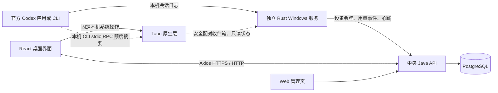

# 当前系统架构

本文描述当前源码的职责划分。桌面源码版本为 `0.3.24`；迁移尚未发布成新安装包，旧版本运行方式不随源码修改自动改变。

## 运行组件

| 组件 | 代码位置 | 职责 |
| --- | --- | --- |
| 桌面界面 | `apps/client/frontend/src` | Axios 直接请求中央 API；登录、额度、团队成员进度条、流水、统计、登录辅助与会话绑定。 |
| 原生层 | `apps/client/frontend/src-tauri` | 窗口/托盘、Windows 用户身份、DPAPI、固定配对文件、本地 Codex CLI RPC、服务状态和脱敏日志。没有本地 HTTP 后端，也不代发中央业务请求。 |
| 统计服务 | `apps/client/meter` | 独立记录、持久保存并上报用量；客户端完全退出仍工作。 |
| 中央 API | `apps/admin/backend` | 唯一业务后端；用户与设备鉴权、幂等计量入库、团队额度、邮箱辅助和会话绑定。 |
| 管理网页 | `apps/admin/frontend` | 管理用户、团队、额度、官方账户及代理配置。 |

旧 `apps/client/backend` 仅留作迁移参考，已移出根 Maven 构建；生产桌面构建和包资源不含 Java/JAR。WebView2 仍采用离线安装器，因此去掉 Java 不等于去掉 WebView2 所占体积。

中央 API 默认端口 8080，管理网页开发端口 8000，桌面开发页面端口 3000。Tauri 生产页面直接访问所选中央服务；中央 CORS 精确允许 Tauri 固定来源、配置的 Web 来源及设备/队列版本头，不使用通配来源。正式部署仍推荐 HTTPS。

## 两套身份与两种额度

Quota Guard 系统账户用于用户、团队和本系统会话；官方 Codex 登录由用户在官方应用或 CLI 自行完成。桌面不转发官方模型请求，也不覆盖官方 `auth.json`。系统退出登录与官方退出是不同操作。

官方额度来自本机 Codex app-server 的 `account/read` 与 `account/rateLimits/read`。原生层仅通过本机 CLI stdio RPC 读取安全摘要；界面用 Axios 上报摘要给中央 API。不把百分比换算成虚构的 Token 数量。

本系统个人、团队额度来自中央已入库事件。成员页面分别显示个人剩余量，以及成员用量占团队已用量的比例。团队历史归属在事件入库时固定，迁队不转移旧用量；未设个人限额会明确标识。

## 配对与用量统计数据流

1. Windows 安装器强制安装或升级 `CodexQuotaGuardMeter`，固定当前 Windows 用户、设备 UUID 和 Codex 日志目录。安装过程批准一次必要的 UAC；不同管理员账户不能替代该 Windows 用户。服务安装/启动或配置验证失败时，安装不能报告成功。
2. 用户登录系统账户后，界面以 Axios 调用中央 `/api/v1/client/meter/enroll`。取得设备专用令牌后，通过固定原生 IPC 原子写入配对收件箱。服务凭据保存在受保护的 ProgramData 目录，后台不依赖界面 access token。
3. 首次启用和配对建立旧日志基线，不追溯既往用量。后续读取新增直接记录，并兼容旧 `event_msg/token_count` 累计格式。直接记录优先，稳定事件 ID 保持中央去重兼容。
4. 新事件和扫描游标先原子写入受保护 outbox，再由独立上传路径发送。慢网络、失败重试不会使采集等待 HTTP；成功 ACK 只移除其确认的事件，不覆盖同时新增记录。
5. 中央依据用户与事件 ID 幂等入库，每批最多 100 条。扫描时间不代表入账时间；重试成功也不一定新增账目。
6. 客户端完全退出后，服务继续采集、排队、续期设备凭据及上报。服务离线时保留本地记录；桌面不再存在第二个扫描器，也不负责安装、重启或保活服务。

## Windows 自启动与故障恢复

统计服务使用 Windows SCM 的自动启动。安装脚本配置故障后第 1、2 次 5 秒重启，后续 30 秒重启，24 小时重置失败计数，并启用非崩溃失败恢复标志。关键采集线程异常应使服务报告失败，由 SCM 处理恢复；普通网络失败保留队列并重试。

没有额外保活 Windows 服务。桌面打开时只读取服务状态，缺失时提示重新运行安装程序。手动停止服务属于明确的管理操作，SCM 不承诺自动撤销该操作。服务不能在关机期间采集，也不能防御设备管理员主动禁用它。

桌面“设置 → 开机自启动”仅控制用户登录 Windows 后是否打开界面，与统计服务自动启动相互独立。正常打开桌面无需为了统计程序再请求管理员权限。

## 修改服务器地址

通过桌面服务器设置保存新地址时，原生层调用固定的 `configure-meter-server.ps1`，仅更新已安装服务的目的地。该脚本不安装服务、不替换二进制、不修复服务策略。

修改会校验 Windows 用户和设备身份，为新服务器准备隔离状态，保留旧服务器的队列和凭据，重启服务以加载新配置，并确认新进程状态。失败会恢复旧配置及连接记录。相同地址不重启服务；如公开连接记录缺失，只校正该记录，不作为保活入口。服务尚未安装时，界面可以保存中央地址并明确显示未安装，随后由安装器读取该地址。

## 桌面登录状态存储（0.3.10）

当前迁移版由 Axios 在内存中保存 access token；refresh token、用户 ID、服务器来源和登录/到期时间通过原生 IPC 使用当前 Windows 用户的 DPAPI 加密保存。不保存密码，不写入 localStorage，不使用 URL 携带令牌。

登录恢复、刷新和业务请求由同一会话管理协调；同时失效的请求共用一次 refresh。登出或切服务器后，旧请求不能恢复旧身份。本地记住登录的期限取首次登录后 7 天与中央 refresh 有效期的较早值；轮换 refresh 不延长原有 7 天期限。

旧 Java AES 包装的会话文件保留，但迁移版不再启动 Java 解密，首次升级可能需要重新登录。设备上报令牌拥有独立生命周期，退出界面或退出系统登录不会自动撤销该设备的统计凭据。

## Windows 安装与旧版本衔接（0.3.5）

保留 currentUser 安装方式及自选目录，按现有兼容策略核对旧注册信息。安装阶段在写入成功注册信息前完成必需服务安装；升级保留设备、游标及队列。更新器卸载阶段不移除服务；普通卸载会停止并移除服务注册，保留统计数据和身份以供重新安装。

## Windows CC Switch 冲突守卫（0.2.20）

保留已核验的本机官方连接与冲突保护能力。普通安装/运行 CC Switch、网络失败或桌面关闭不等于冲突。守卫仅在可信本机证据和精确进程身份支持时执行保护；守卫的展示、状态或审计失败不得阻止本地计量持久化。保护行为不能代替中央账户归属核验。

## 日志与排障

- Windows 服务：`CodexQuotaGuardMeter`，系统“服务”管理器可检查启动类型与恢复配置。
- 当前用户应用数据：`%APPDATA%\com.codexquotaguard.desktop`，包含安全会话、服务器设置、设备身份、公开状态及脱敏运行日志。
- 私有计量：`%ProgramData%\CodexQuotaGuard\Meter`，包含设备凭据、outbox、游标、隔离上下文和私有审计日志。不要手动删除队列或更改记录归属，也不要放宽此目录权限。
- 安装失败摘要：`meter-setup-status.json`；只含步骤和固定诊断，不含密码或令牌。
- 桌面日志只展示固定摘要，批次 Token 不是新增流水，不能重复累计。公开日志不可作为计费依据。

统计状态不明确时先核对当前服务器、设备、服务版本和最近采集/上报时间；短暂离线可以重试。服务未安装或可执行文件损坏时重新运行安装程序，不在客户端中创建另一套计量兜底。

## 从源码验证

在项目根目录安装 JS 依赖后运行 `pnpm dev:client` 或双击 `一键启动-桌面客户端.cmd`。桌面开发需要 Node.js、pnpm、Rust 及 Tauri 的 Windows 构建依赖；只有中央后端开发需要 Java/Maven。开发启动脚本不安装或修复统计服务。

首次测试独立统计服务时，先运行 `pnpm --dir apps/client/frontend build:meter`，再在当前用户的管理员 PowerShell 中运行 `scripts/windows/install-meter-service.ps1 -ServerUrl <中央地址> -BinaryPath <项目内打包资源中的quota-guard-meter.exe>`。该操作会安装真实服务，请在需要验证时执行。安装后的服务可以在桌面退出后继续测试。

正式构建入口是 `scripts/windows/package-client.ps1`，默认产物在项目 `dist/build-target`；生产包只包含桌面、Rust 服务及必要系统运行时。当前重构未发布安装包，旧 `dist/desktop-v0.3.24` 产物仍含旧架构，不代表本次改造结果。
